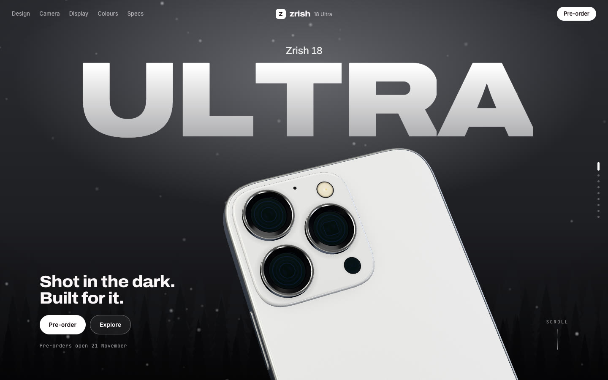
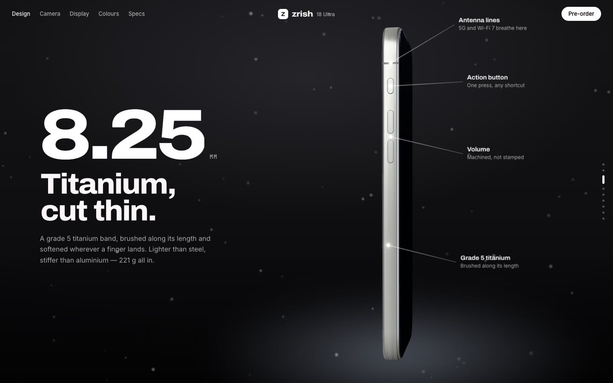
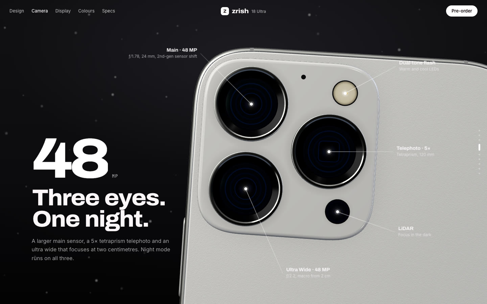
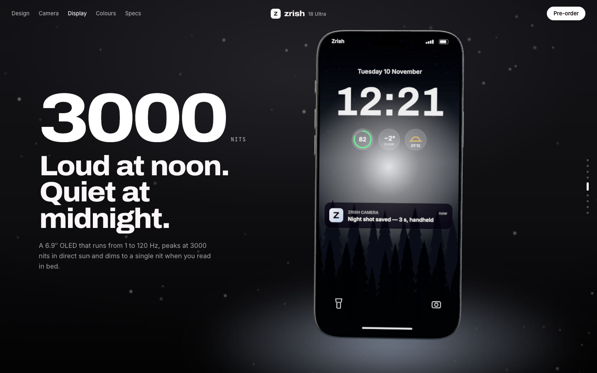
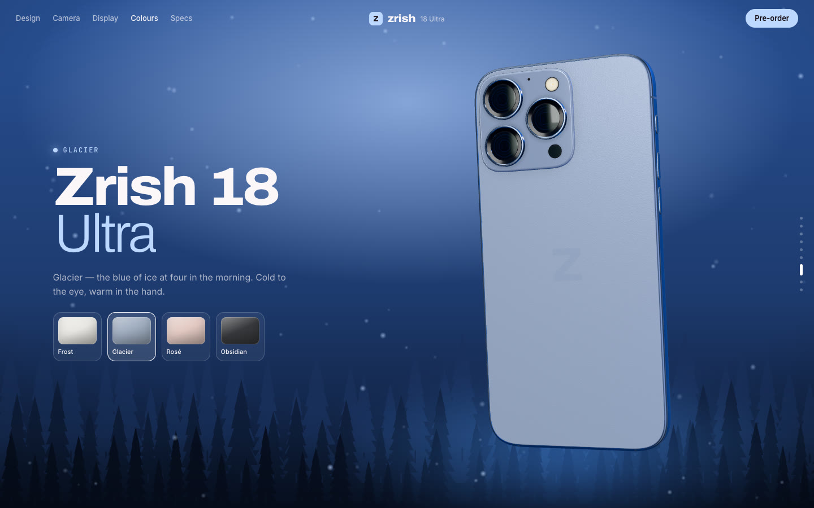
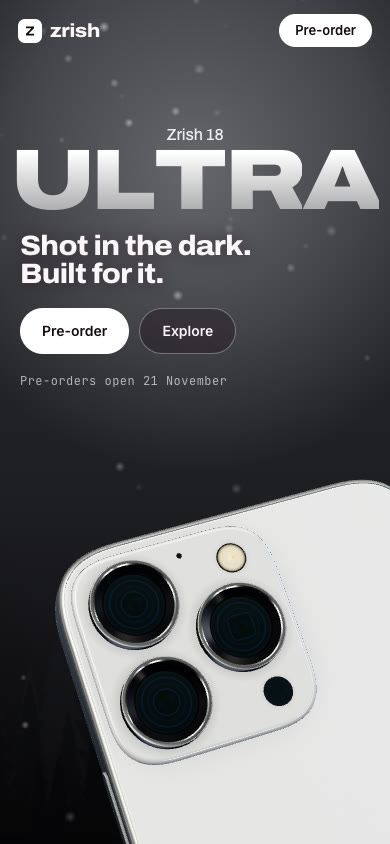

# Zrish 18 Ultra — phone launch site

Concept product page for a fictional phone. One 3D phone, modelled in code to real proportions (77.6 × 163 × 8.25 mm), turns and travels through the page as you scroll: the camera block under a giant ULTRA, the titanium edge in profile, a macro of the lenses with callouts, the lock screen splitting into layers, a colour run that repaints the whole scene, and a finale.



| Titanium edge | Camera |
| --- | --- |
|  |  |

| Display | Colours |
| --- | --- |
|  |  |



## Features

- **A phone built from code.** No model files: the body, lens cups, buttons, ports and screws are generated from squircle outlines and swept profiles, measured in millimetres. Materials are physical: brushed titanium with anisotropic highlights, matte etched glass with a glossy logo, sapphire lenses with a tinted coating.
- **Studio light.** A gradient dome with softboxes is baked into an environment map and re-baked when the finish changes; rect-area lights draw the long soft highlights.
- **Scroll as choreography.** Every section has pose keys: position, rotation, pivot point, finish, background darkness, glow and screen state. The scene blends between them with damping, an idle float and pointer parallax; pass-through keys let a move flow on without stopping. Phones get their own poses.
- **A first scroll with a spin.** The phone leaves the camera close-up in one full turn: the letters of ULTRA part around it, and the screen lights up for the moment it faces you.
- **Live lock screen.** Drawn on canvas: a wallpaper with pines, the real time and date, widgets and a notification. In the Display section the layers separate in depth.
- **Callouts that stick.** Labels hang on 3D anchor points that are projected to the screen every frame.
- **Colour run.** The page is set in Frost: white titanium against a near-black night. In the Colours section the phone spins through Glacier, Rosé and Obsidian while the background, glow, forest and accents follow.
- **Details.** Scramble counters, word-by-word reveals, drifting dust, a loader that waits for the scene, adaptive resolution, and `prefers-reduced-motion` is respected.

## Stack

Plain HTML, CSS and JavaScript, no build step. Libraries load from CDN:
[Three.js](https://threejs.org) 0.170, [GSAP](https://gsap.com) 3.13, [Lenis](https://lenis.darkroom.engineering) 1.3.

## Run locally

The 3D scene is an ES module, so open the site through a local server, not by double-clicking `index.html`:

```bash
python3 -m http.server 8000
```

Then go to http://localhost:8000.

It also works on GitHub Pages as is: Settings → Pages → deploy from the `main` branch, root folder.

## Structure

```
index.html      markup: hero, design, camera, display, battery, colours, finale, specs
css/style.css   layout, callouts, type, phone layout
js/geo.js       geometry: squircles, profile sweeps, lathes, caps
js/tex.js       procedural textures: glass grain, brushed titanium, lenses, flash, LiDAR
js/phone.js     the phone: body, camera block, buttons, materials, anchor points
js/screen.js    lock screen drawn on canvas, split into layers
js/scene.js     renderer, studio light, scroll keys, callouts and glow
js/app.js       scrolling, section layout, reveals, counters, colour picker, loader
js/air.js       forest silhouettes and floating dust
docs/           screenshots for this README
```

## Note

Zrish, the Zrish 18 Ultra, its specs and prices are fictional. This is a design and development demo, not affiliated with any phone maker.
